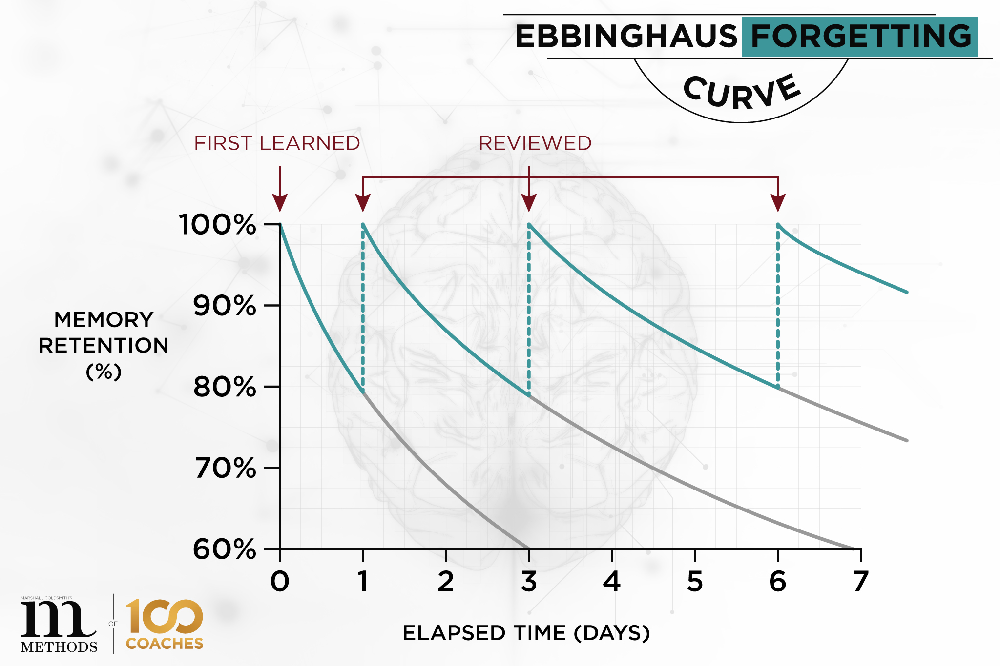
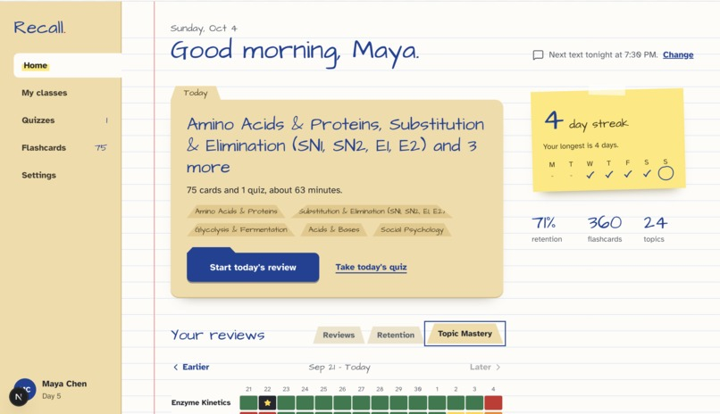
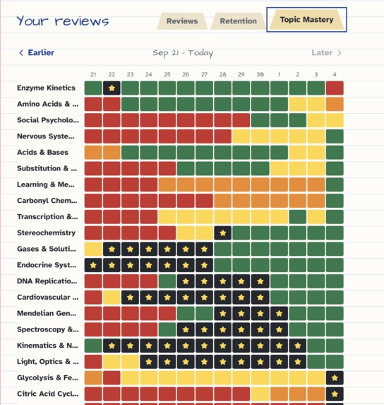
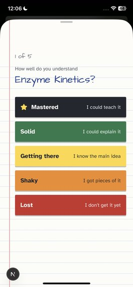
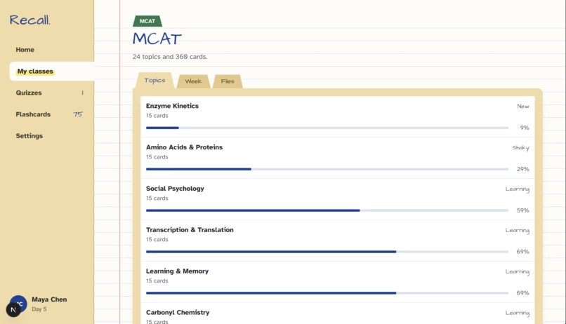
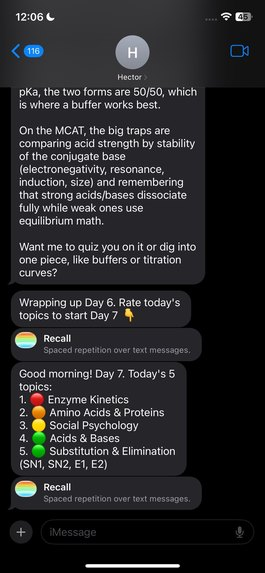

+++
date = '2026-11-07T01:11:19-05:00'
draft = false
title = 'MHacks Reflection'
image = 'mhacks-banner.png'
+++
MHacks is the largest hackathon in the midwest, with over 500 participants coming in from around the country each year. I knew going into it that MHacks was one of the most prestigious hackathons in the country, the world even, but it wasn't until most of my friends were rejected that I realized only the cream of the crop would be attending. Sure, I've been to hackathons with 200-300 people and knew this would be larger. I've even been to SpartaHacks, which hosts a similar number of people. But the caliber of the participants was just on another level.

I teamed up with Bala from UC Irvine, Adam from UT Arlington and Devin from GrizzHacks (only he and I were accepted). We built a spaced-repetition grounded study app called "Recall" that reminds you each morning what topics you need to study most. Although I'm proud of Recall and think it's a genuinely useful project, I also understand why Recall didn't win anything. The hackathon landscape is changing immensely, and projects that would raise eyebrows and win in the past simply aren't enough to cut it anymore.

## About Recall

Studying for something long-term like the MCAT is difficult––you not only have to learn everything, but over the course of several months you have to *remember* everything. You have to combat the forgetting curve, which pretty much just states that every time you learn something, you begin to forget it until it's learned again.

That's why *spaced repetition* is important. Every so often, it's important to review what you've learned. It turns out your time is much better spent revisiting a topic every so often briefly as opposed to intensely studying it for one night. There are many algorithms that exist which decide exactly how much repetitions should be spaced, but at the end of the day, it's up to the person to diligently keep track of their progress and perform calculations. Recall uses the open source Free Spaced Repetition Scheduler by the Anki team to not only keep track of reps, but also notify the user each morning which topics they need to study via iMessage.

Photon exposes a chat-interface agents can use via iMessage, and was actually really easy to use. We created an agent named "Hector" (you know, the Remember Me guy from Coco) that sends automated reminders and can chat with the user. We also created mini-apps in Swift that the user can open directly from iMessages, like daily flashcards and an end of day topic-confidence rating system. From your desktop, you can see exactly which topics you studied when and their confidence, create new topics and new flashcards. The next step is to allow the upload of csv's to bulk upload flashcards, or allow Agents to create topics and flashcards about any topic. This is honestly an easy feature to add with LLM's––we just didn't get around to it.

So I'm actually very happy with Recall––it contains everything I ever wanted in a study app, and it's incredibly convenient. So why didn't it win?
### Introducing Muse

This is Muse. Muse is an adorable personalized AI agent always working in the Cloud for you invented by Meta. Muse is kind of like OpenClaw, but more capable and with fewer security issues. 

Since Muse "has its own computer", it's always on and always able to execute tasks for you. It's able to open and interact with browsers, send emails, read and summarize your Calendar events, and much more. To be honest, I hadn't heard of Muse before MHacks, but it turns out people are already using it in unique ways. My partner from Texas, for example, uses it to find internships and then custom tailor his resume for those positions every morning. That's how customizable and broadly powerful Muse is.

It really sucks to admit, but we're just at a point in technology where someone who wanted the capabilities of Recall could ask Muse to do exactly what we worked so hard on. Muse could generate flashcards, remember topics, recommend topics to study/refresh every morning, and text you daily reminders. Muse could explain any problems you struggle with, even point them out without you asking based on test data. Muse could integrate with Anki or Quizlet, making your life even easier. You could upload a slideshow or syllabus to Muse, and it could use that data to create topics and questions. All of this is not only already done, but is possible *without even being explicitly created*. Muse just has the broad intelligence and skillset to do it out the box.

And this is just the truth––we are scarily close to AGI. We can debate whether today's AI classifies as AGI, and whether intelligence will take off beyond human intelligence. However, I think it's undeniable that if we were to seriously adopt AI as it is today, it very well could replace much of society's needs after we fully adjust to it. The benefit is just offset by the risk of AI messing up when it does something important wrong, and of malicious AI taking advantage of humanity.

Business idea: AI insurance for when your personal agent catastrophically screws your finances.

## Other Things That Impressed Me

Other things that impressed me:
- The Unitree Go2 dog and Boston Dynamics Dog
- MetaQuest VR Glasses
- Real-time Translation Glasses

Robotics and AR/VR are taking huge leaps forward as well, unsurprisingly, with advancements in AI. It's probably not long until we develop models capable of reasoning through the physical world for robots to use. And we're already at a point where seemingly normal glasses can translate languages in real-time, invisible to the outside world. All of this feels straight out of a sci-fi movie, and I know we're only at the beginning of the S curve.

## So What Wins Hackathons?

Software products aren't enough to win hackathons anymore, because everyone has access to coding agents like Claude and Codex. Anyone with a half-decent idea can execute on it and create a working product in 24 hours. In fact, almost *double* the number of expected teams demo'ed, resulting in a massive internet crash during demos. 

If everyone is able to vibe code a software product, then very few software products are going to appear impressive anymore. As a result, a large majority of the projects that won included some kind of hardware element, and the groups that won began with a demo vision.

## Conclusion

I'm leaving MHacks with many questions about our future. The state of agents is taking off like the gold rush, and the result is going to be a transformation in how we interact with technology. If features like Recall are now possible for personal agents, then we'll be offloading more and more of our lives as we discover creative ways to automate them. One agent not enough––why not have multiple? Fleets of AI agents could be doing work for you behind the scenes, even without your prompting. So what will that leave people to work on?

I think we're still figuring it out, and that nuance is interesting to me. If agents are faster, smarter, more diligent and always on, any personally carried out task with intellectual substance becomes a choice, not a need. As tools like the steam engine developed, people who prided themselves on their physical gifts had to reconcile with competing against machines. Intelligence became the one thing machines couldn't replace, and so kids were told to stay in school and study hard, and they would be rewarded. Society financial rewarded intelligence, because it couldn't be done by machines. But now, the playing field is evening out, and that promise is being taken back. Is it fair? Is it unfair? My friend works in construction, and spends winters carrying steel beams up and down flights of stairs in the exposed cold for $21/hour. I take sit around and update websites for $28/hour. Is that fair?

I'll end with this––MHacks brought in the CEO's of Beli for the opening ceremony. Beli is a niche, hippie foodie app that allows people to rate their favorite places to eat, and it's been exploding online. It's got a slick UI, featuring an interactive map with rating bubbles. And yet, if it was built at MHacks, I doubt it would've won anything. Such is the landscape of hackathons, and the future––it's an incredible app, but the world is just changing that much.
