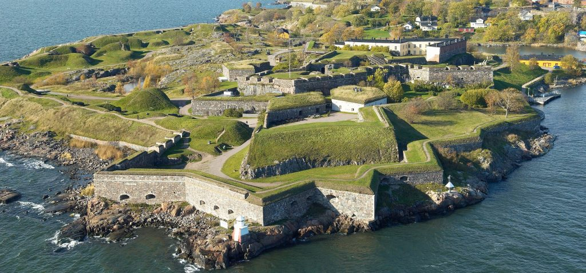

+++
date = '2026-11-14T19:16:53+02:00'
draft = false
title = 'Suomenlinna'
+++
In November, it's cold, windy, rainy and gray in Helsinki. Sunlight lasts from 9:00 to 3:00 PM. It's hardly the "happiest place in the world" that I'd imagined, but the public transit system makes up for it. Traveling is as easy as purchasing an HSL day pass, and then showing the QR code to use all busses, trams, metros and even the ferry's. I pretty much just walked onto the Suomenlinna ferry on accident, and suddenly I was on a UNESCO world heritage site.

Suomenlinna is a sea-fort island designed in the style of European bastion fortification around 1750. It has these vertices jutting out of its body, like a giant petrified starfish. Its garrisons are low and hushed over by dirt and grass into knolls, so that from the sea it appears harmless. Only when it's too late will the enemy notice the fort walls and cannon fire.

It was nicknamed the Impregnable "Gibraltar of the North". In 1808, Suomenlinna was surrendered without a fight.

I don't think I'm very good at distinguishing history and mythology. I don't think I quite comprehend the human lives behind them. On Suomenlinna, however, the lack of tourism and dense elements in mid-November made me feel like a Swede or Russian occupying base. I patrolled the base among fellow soldiers, hid in the garrisons from the cold with them, and feared for the day of battle. For years, nothing would ever happen. It would only take one decisive moment to make history.

1918, Suomenlinna would see battle in the Finnish Civil War. 38,000 or so Finns died, accounting for 1% of the population. I don't need to be a statistician to know 1% is not a rounding error. War is like a volcano; after years of dormancy, murder erupted for 2 months.

I only experience peace because of the wars and deaths of those before me. That threat of power is always looming in the background, ensuring others don't interfere with our lives. I hate the amount we spend on defense, but in moments like these, I remember why we choose to.

